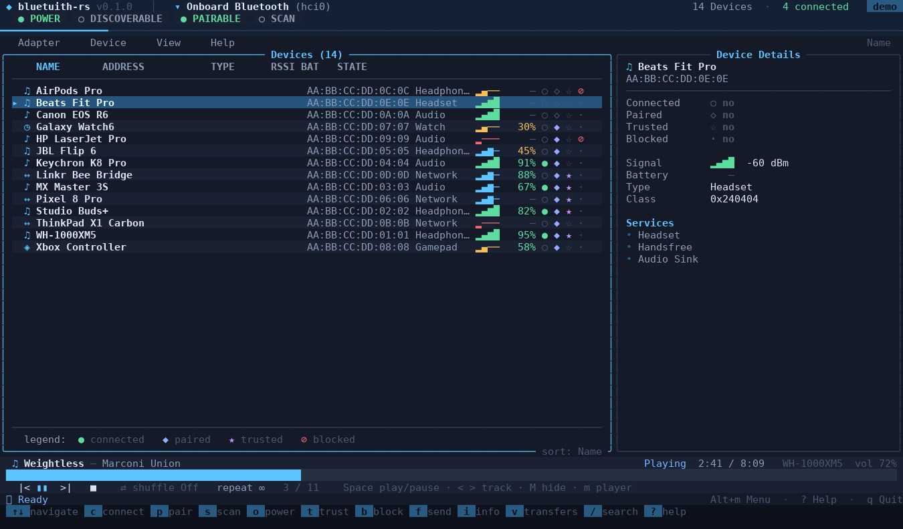
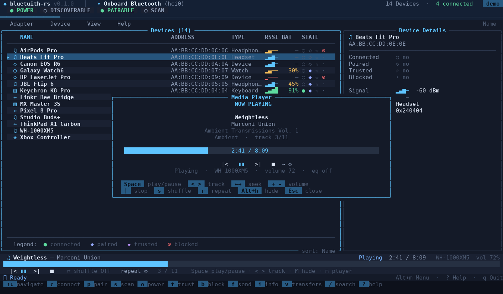
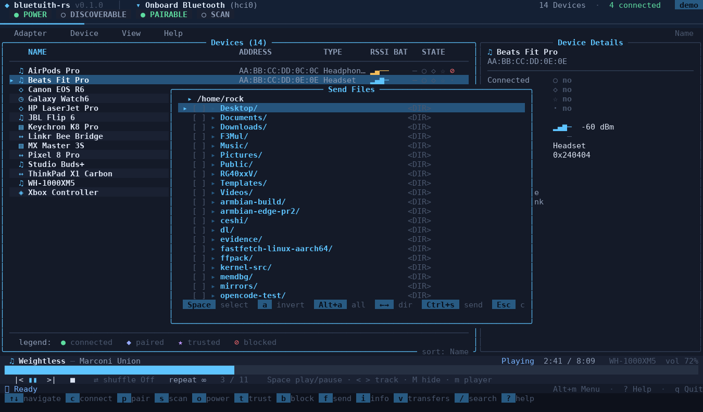
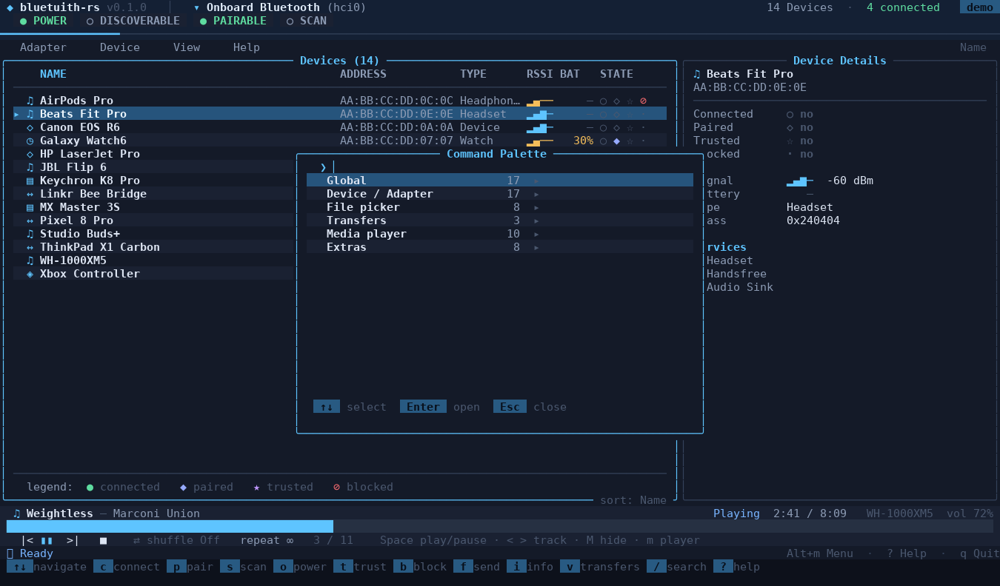
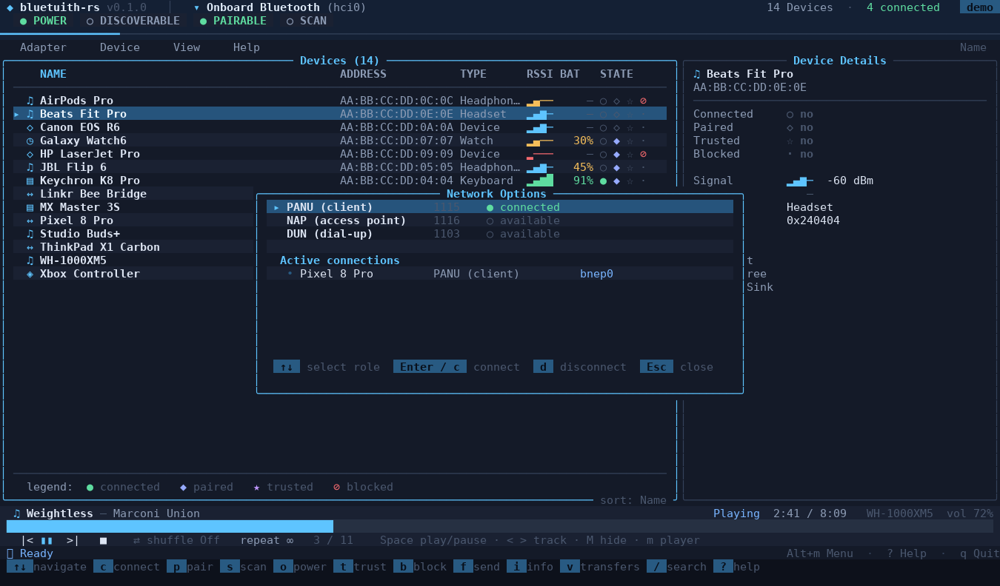
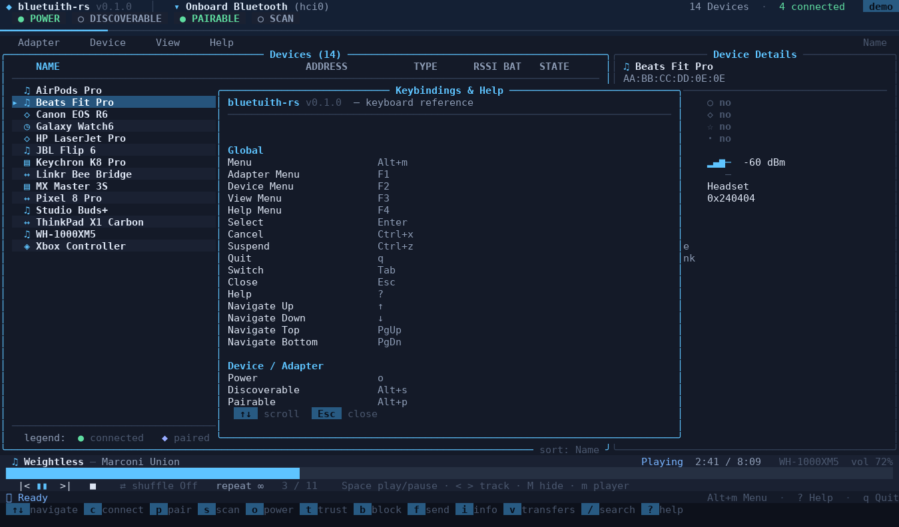
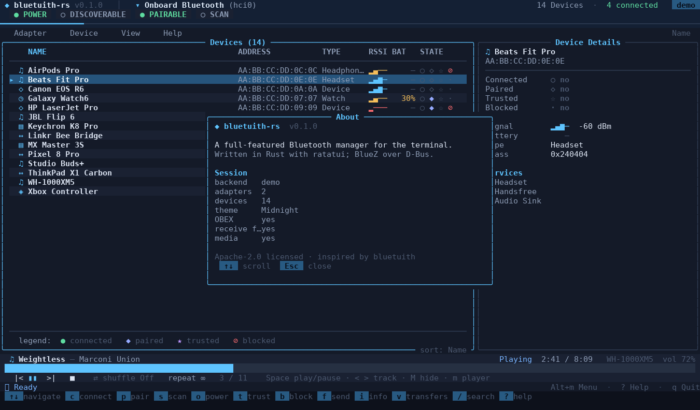

# bluetuith-rs

[](https://github.com/Novice-PG/bluetuith-rs/actions/workflows/debs.yml)
[](https://github.com/Novice-PG/bluetuith-rs/releases)
[](LICENSE)
[](https://www.rust-lang.org/)

A full-featured Bluetooth manager for the terminal, written from scratch in
**Rust** with [ratatui](https://ratatui.rs/) and
[zbus](https://github.com/dbus2/zbus).



`bluetuith-rs` is a clean-room reimplementation of the *idea* behind
[bluetuith](https://github.com/bluetuith-org/bluetuith) (a Go/tview Bluetooth
TUI). It contains no Go code and no code copied from bluetuith: the models,
BlueZ D-Bus backend, event loop and every widget are original Rust. It keeps
feature parity with the original and adds a handful of extras. See
[Origin, inspiration & licensing](#origin-inspiration--licensing) for how this
relates to the original project legally.

---

## Contents

- [Highlights](#highlights)
- [Screenshots](#screenshots)
- [Feature parity with bluetuith](#feature-parity-with-bluetuith)
- [Install](#install)
- [Usage & keybindings](#usage--keybindings)
- [Configuration](#configuration)
- [Known limitations](#known-limitations)
- [Architecture](#architecture)
- [Building `.deb` packages for all Linux architectures](#building-deb-packages-for-all-linux-architectures)
- [Development & testing](#development--testing)
- [Origin, inspiration & licensing](#origin-inspiration--licensing)
- [License](#license)

## Highlights

- **Complete Bluetooth management over BlueZ D-Bus** — adapter power,
  discoverable/pairable modes, discovery, device connect/disconnect, pairing,
  trust, block and remove.
- **Live device list** with signal-strength bars, battery level, device kind,
  paired/connected/trusted/blocked badges, search/filter and six sort modes.
- **OBEX Object Push send and receive** with a file picker, per-transfer
  progress, suspend/resume/cancel, an authorization dialog for incoming files
  and `receive-dir` as the landing directory (via `org.bluez.obex.Agent1`).
- **Media player** (AVRCP / `org.bluez.MediaPlayer1`) with play/pause,
  next/previous, seek, stop, volume, shuffle/repeat, track metadata and a
  mini-player bar.
- **PAN networking** (PANU / NAP; DUN reserved) and **audio profile** views.
- **Real pairing agent** — PIN, passkey, numeric comparison, authorization and
  incoming-file prompts are blocking D-Bus dialogs, not decorative ones.
- **Nine built-in palettes**, runtime theme switching, custom accent colour,
  configurable keybindings with conflict detection, full mouse support,
  right-click context menus, a two-level command palette, event log and help.
- **Bilingual UI** — English and Chinese (中文), auto-detected from `$LANG`,
  switchable at runtime with `L` or via `--lang` / `language = "zh"`.
- **`--demo` mode** — a fully interactive simulated adapter, so every screen
  works (and is testable) on a machine with no Bluetooth hardware.
- **Single static binary** — `.deb` packages for 12 Linux architectures, with
  no runtime dependencies beyond D-Bus/BlueZ (optional in `--demo`).

## Screenshots

All images are generated directly from the rendering code by
`examples/snapshot.rs` + `packaging/render-snapshot.py` (see
[Development](#development--testing)), so they always reflect the real UI.

<details>
<summary><b>Main view</b> — device table, details side panel, legend, mini player</summary>


</details>

<details>
<summary><b>Media player</b> — AVRCP controls, seek bar, shuffle/repeat, volume</summary>



</details>

<details>
<summary><b>File picker</b> — OBEX Object Push send with multi-select</summary>



</details>

<details>
<summary><b>Command palette</b> — two-level category → action launcher</summary>



</details>

<details>
<summary><b>Network</b> — PANU / NAP / DUN roles and active connections</summary>



</details>

<details>
<summary><b>Help</b> — live keybinding reference generated from the current keymap</summary>



</details>

<details>
<summary><b>About</b> — backend, feature flags and version</summary>



</details>

## Feature parity with bluetuith

| Area | bluetuith (Go) | bluetuith-rs (Rust) |
|---|---|---|
| Adapter selector + status indicators | ✓ | ✓ |
| Power / Discoverable / Pairable / Scan | ✓ | ✓ |
| Connect / Disconnect / Pair / Cancel pairing | ✓ | ✓ |
| Trust / Untrust / Block / Unblock / Remove | ✓ | ✓ |
| Device info + service UUIDs | ✓ | ✓ |
| File picker (select / invert / all / hidden / refresh) | ✓ | ✓ |
| OBEX Object Push send + transfer progress view | ✓ | ✓ |
| OBEX receive + `receive-dir` | ✓ | ✓ (OBEX Agent1) |
| Transfers suspend / resume / cancel | ✓ | ✓ |
| Pairing + file-transfer authentication views | ✓ | ✓ |
| Media player (play/pause/next/prev/seek/stop/shuffle/repeat) | ✓ | ✓ |
| Network options (PAN/NAP/DUN) | ✓ | PANU / NAP ✓; DUN reserved |
| Audio profiles | ✓ | list only (BlueZ has no switch API) |
| Mouse support | ✓ | ✓ |
| Configurable theme + keybindings | ✓ | ✓ |
| Help / keybinding view | ✓ | ✓ |
| Suspend (`Ctrl+Z`) / quit confirmation | ✓ | ✓ |
| CLI flags + config file + env vars | ✓ | ✓ |
| `--list-adapters` non-interactive mode | ✓ | ✓ |
| Device search / filter | — | ✓ |
| Six sort modes | — | ✓ |
| Battery + RSSI + device-kind icons | — | ✓ |
| Details side panel | — | ✓ |
| Nine palettes + live theme picker | — | ✓ |
| Command palette, event log | — | ✓ |
| Bilingual UI (English / 中文) | — | ✓ |
| `--demo` simulated adapter | — | ✓ |
| Static multi-arch `.deb` packages | — | ✓ |

## Install

### Debian / Ubuntu package

Prebuilt `.deb` files for 12 architectures are attached to every GitHub
Release. To build them locally with `packaging/build-debs.sh`:

```sh
./packaging/build-debs.sh
sudo dpkg -i packaging/out/bluetuith-rs_0.1.0_amd64.deb   # or arm64, armhf,
                                                          # armel, i386, ppc64el,
                                                          # riscv64, loong64, ppc64
```

The package installs `/usr/bin/bluetuith-rs`, a man page, a desktop entry,
shell completions and an example config. It has no runtime dependencies besides
a system D-Bus and BlueZ (both optional in `--demo` mode).

### From source

```sh
cargo build --release --bin bluetuith-rs
sudo install -m755 target/release/bluetuith-rs /usr/local/bin/
```

Requires Rust 1.85+. On Linux the only system requirement is a running D-Bus
system bus; BlueZ is optional (without it, use `--demo`).

**Bluetooth file transfers** additionally need `bluez-obexd` (the `obexd`
daemon). On most distributions `org.bluez.obex` is a *session*-bus service, so
the app probes/activates it on the session bus first and falls back to the
system bus. If no OBEX service is available the "Send file" action is disabled
and the UI tells you to start it, e.g.:

```sh
sudo apt install bluez-obexd
systemctl --user start obex.service
```

## Usage & keybindings

```sh
bluetuith-rs                 # attach to BlueZ
bluetuith-rs --demo          # run against a simulated adapter
bluetuith-rs --theme Nord    # pick a palette
bluetuith-rs --list-adapters # print adapters and exit
bluetuith-rs --generate      # write a default config file
bluetuith-rs --help
```

### Main keybindings

| Key | Action | Key | Action |
|---|---|---|---|
| `↑` `↓` | navigate | `c` | connect / disconnect |
| `p` | pair | `t` | trust / untrust |
| `b` | block / unblock | `d` | remove device |
| `o` | power | `s` | scan |
| `Alt+s` | discoverable | `Alt+p` | pairable |
| `a` | change adapter | `f` | send files |
| `v` | transfers | `m` | media player |
| `Alt+h` | hide player | `n` | network options |
| `Alt+a` | audio profiles | `i` | device info |
| `/` | search / filter | | |
| `F1` `F2` `F3` `F4` | Adapter / Device / View / Help menu |
| `F5` | cycle sort | `F6` | toggle details |
| `F7` | theme picker | `F8` | event log |
| `F9` | about | `Ctrl+p` | command palette |
| `Alt+m` | menu bar | `l` | switch language (en / zh) |
| `?` | help | `q` | quit |
| `Ctrl+z` | suspend | `Ctrl+x` | cancel |
| `Esc` | close overlay | | |

In the media-player window: `Space` play/pause, `<` `>` previous/next,
`←` `→` seek, `+` `-` volume, `]` stop, `s` shuffle, `r` repeat, `Alt+h` hide.

Double-click a device row to connect; right-click opens the device context
menu. `Esc` closes any overlay. Every binding can be overridden — see below.

### Configuration

`~/.config/bluetuith-rs/config.toml` (or `$XDG_CONFIG_HOME`). Generate a
commented default with `--generate`:

```toml
adapter = "hci0"
receive-dir = ""
gsm-number = "*99#"
adapter-states = "powered:yes,discoverable:no,scan:no"
connect-bdaddr = ""
confirm-on-quit = true
no-help-display = false
theme = "Midnight"
accent = "#5ec4ff"
default-sort = "Name"
language = "en"            # en | zh, or auto-detected from $LANG
show-hidden-files = false
scan-on-start = false

[keybindings]
# Quit = "Ctrl+q"
# Connect = "c"
```

All options also have `--flag` equivalents and `BLUETUITH_RS_*` environment
variables. Built-in palettes: **Midnight**, **Nord**, **Catppuccin**,
**Dracula**, **Gruvbox**, **Tokyo Night**, **Rosé Pine**, **Solarized**,
**Daylight**.

## Known limitations

- **Audio profiles** are listed for information only. BlueZ has no API to
  switch A2DP/HFP — that is done by `bluez-alsa`, PipeWire or PulseAudio — so
  the profile window is read-only on real hardware (the `--demo` simulator can
  toggle them).
- **OBEX file transfer** needs `bluez-obexd`. Incoming files are authorized
  through a registered `org.bluez.obex.Agent1` and written under `receive-dir`
  (default `~/Downloads/bluetuith-rs`). Transfers are controlled through the
  OBEX `Transfer1` D-Bus interface. A real incoming push still needs a peer
  device; only the D-Bus contract has been verified locally.
- **DUN dial-up** (`gsm-apn` / `gsm-number`) is reserved for a future PPP
  implementation. Selecting the DUN role reports "not provided by BlueZ
  `Network1`" instead of firing a call that cannot work; only PANU/NAP go
  through `Network1.Connect` (with a full 128-bit UUID). Setting either GSM
  option also prints a startup warning that they currently have no effect.
- **Network list** is synthesised from connected devices and their advertised
  service UUIDs — BlueZ exposes no standalone BNEP connection object. A
  disconnect is remembered for the session so it does not reappear on the next
  poll.
- **Player volume** is applied through `org.bluez.MediaTransport1.Volume`
  when the adapter exposes it; otherwise the system mixer must be used.
  Shuffle/repeat are written to `MediaPlayer1.Shuffle` / `Repeat` (`s` / `r`
  in the player window).
- The **command palette** is two-level (categories → commands); `Esc` in the
  second level returns to the category list. Window-scoped commands open the
  window they belong to.
- Raw D-Bus error text is intentionally left in English for diagnostics; all
  other UI and status text is translated.
- **Not end-to-end verified** (needs a peer Bluetooth device): a real pairing
  dialog exchange, AVRCP playback against a phone, a live PAN connection and a
  real incoming OBEX push. The D-Bus calls and arguments are checked against a
  fake BlueZ service by `examples/contract.rs`, and `examples/real_prop.rs`
  verifies adapter writes on real hardware.

## Architecture

```
src/
├── model.rs          plain data types (no terminal, no D-Bus)
├── backend/
│   ├── mod.rs        Backend trait, Command/Event, service names
│   ├── bluez.rs      BlueZ over zbus (blocking D-Bus on a worker thread)
│   └── demo.rs       deterministic simulator used by --demo and the tests
├── app.rs            application state + all input handling
├── config.rs         TOML config, CLI/env overrides
├── keybind.rs        configurable bindings + conflict detection
├── theme.rs          colour palettes
├── i18n.rs           EN/ZH text tables + backend status translation
├── ui/               ratatui rendering (chrome, views, overlays)
└── main.rs           CLI entry, terminal setup, event loop
```

The UI never touches BlueZ directly: it sends `Command`s and reacts to
`Event`s. The BlueZ worker polls
`org.freedesktop.DBus.ObjectManager.GetManagedObjects` on `org.bluez` (and
`org.bluez.obex` when available), executes operations through `org.bluez.*`
methods, and registers a pairing `org.bluez.Agent1` and an OBEX receive
`org.bluez.obex.Agent1`, both of which block until the user answers the
prompt. Polling instead of signal subscriptions keeps the state machine simple
and resilient to BlueZ's many optional interfaces.

Feature availability is reported at runtime: if `obexd` or a media player is
absent, the corresponding controls stay visible but report that the service is
unavailable.

## Building `.deb` packages for all Linux architectures

`packaging/build-debs.sh` cross-compiles a **static** binary per target using
`rustup target add` + Rust's bundled `rust-lld` (so no cross C toolchain is
needed) and wraps it with `dpkg-deb`:

```sh
./packaging/build-debs.sh                 # all supported targets
./packaging/build-debs.sh aarch64-unknown-linux-musl   # one target
```

| Debian arch | Rust target | Debian arch | Rust target |
|---|---|---|---|
| `amd64` | `x86_64-unknown-linux-musl` | `arm64` | `aarch64-unknown-linux-musl` |
| `armhf` | `armv7-unknown-linux-musleabihf` | `armel` | `arm-unknown-linux-musleabi` |
| `i386` | `i686-unknown-linux-musl` | `ppc64el` | `powerpc64le-unknown-linux-musl` |
| `riscv64` | `riscv64gc-unknown-linux-musl` | `loong64` | `loongarch64-unknown-linux-musl` |
| `ppc64` | `powerpc64-unknown-linux-musl` | | |

Architectures that Rust only ships `*-linux-gnu` std for (`s390x`,
`sparc64`, `mips*`) are built by the GitHub Actions matrix in
`.github/workflows/debs.yml` using Debian's cross toolchains. Every package is
verified with `dpkg-deb --info`.

## Development & testing

```sh
cargo test --all-targets                                # unit + integration tests
cargo clippy --all-targets -- -D warnings
cargo run --example snapshot -- 150 44 main /tmp/frame.json   # render a screen to JSON
python3 packaging/render-snapshot.py /tmp/frame.json /tmp/frame.png
cargo run --example full_sim                            # end-to-end functional checks (demo)
dbus-run-session -- cargo run --example contract        # low-level BlueZ D-Bus contract
cargo run --example real_prop                           # real adapter write → read-back → restore
```

`examples/snapshot.rs` renders any screen into a `TestBackend` and dumps every
cell; that is how the screenshots above are produced without a real terminal.
`examples/full_sim.rs` drives the real `App` state machine against the demo
backend and asserts that every action, overlay, mouse path and command actually
takes effect.

`examples/contract.rs` is the lowest-level check: it starts a **fake BlueZ
service on a private D-Bus bus**, points the real `BluezBackend` at it via
`DBUS_SYSTEM_BUS_ADDRESS`, and asserts the actual D-Bus traffic (method names,
interfaces, argument values, full 128-bit UUIDs, session-vs-system bus for
OBEX) plus the parsing of hand-built `GetManagedObjects` replies including
variant integer widths and missing properties. It also verifies a slow OBEX
call does not stall the polling thread — no hardware and no root needed.
`examples/real_prop.rs` goes the other way: on real hardware it makes the
program set `Discoverable`, reads the value back through a separate D-Bus
connection, then restores it.

## Origin, inspiration & licensing

This project was inspired by **[bluetuith](https://github.com/bluetuith-org/bluetuith)**,
the Go/tview Bluetooth TUI by **darkhz**, released under the **MIT License**
(`Copyright (c) 2022 darkhz`). We are grateful for the design and feature set
it pioneered; this Rust project is an independent reimplementation of that
*idea*, not a port or a derivative of its source code.

### Is a Rust rewrite of a Go project a copyright problem?

Short answer: **reimplementing the same functionality in a different language
with independently written code is lawful**, and here specifically it is on
solid ground. The reasoning:

- **Copyright protects expression, not ideas or functionality.** US law
  (17 U.S.C. §102(b) and the Copyright Office's
  [2016 software report](https://www.copyright.gov/policy/software/software-full-report.pdf))
  explicitly excludes ideas, procedures, systems and methods of operation. The
  EU reached the same conclusion in *SAS Institute v World Programming*
  (CJEU C-406/10): a program's functionality, programming language and data
  formats are not protected by software copyright. Writing new Rust code that
  does what a Go program does is therefore not, by itself, infringement.
- **Clean-room reimplementation is an established, lawful industry practice.**
  The US Copyright Office report notes that clean-room implementations "have
  long been used … to ensure the development of competitive products" (the
  classic example being Phoenix's BIOS). This project was written as original
  Rust — no Go source, no translation of Go files, no copied code.
- **The original is MIT — one of the most permissive licenses.** Even in the
  hypothetical case that a fragment were reused, the MIT license grants rights
  to "use, copy, modify, merge, publish, distribute, sublicense, and/or sell"
  copies. Its only condition is that the copyright and license notices be
  retained. MIT is [permissive and GPL-compatible](https://www.gnu.org/licenses/license-list.html)
  and fully compatible with this project's Apache-2.0 license.
- **What we deliberately did *not* copy:** upstream source code, logos/icons,
  screenshots, documentation prose or the "bluetuith" product name/trademark.
  This project is published as **bluetuith-rs**, explicitly credits upstream,
  and makes no claim of affiliation or endorsement. UI labels such as
  "Connect"/"Pair" and functional configuration keys are dictated by the
  Bluetooth domain and are not protectable expression (the *merger* and
  *scènes à faire* doctrines).

For completeness — though not legally required for a clean-room rewrite — the
upstream MIT license text and copyright notice are preserved in
[NOTICE](NOTICE) as an attribution record.

> This is general information, not legal advice. If you need a definitive
> assessment for a commercial or distribution context, consult a qualified
> lawyer.

## License

Apache-2.0. See [LICENSE](LICENSE). Upstream attribution is recorded in
[NOTICE](NOTICE).
