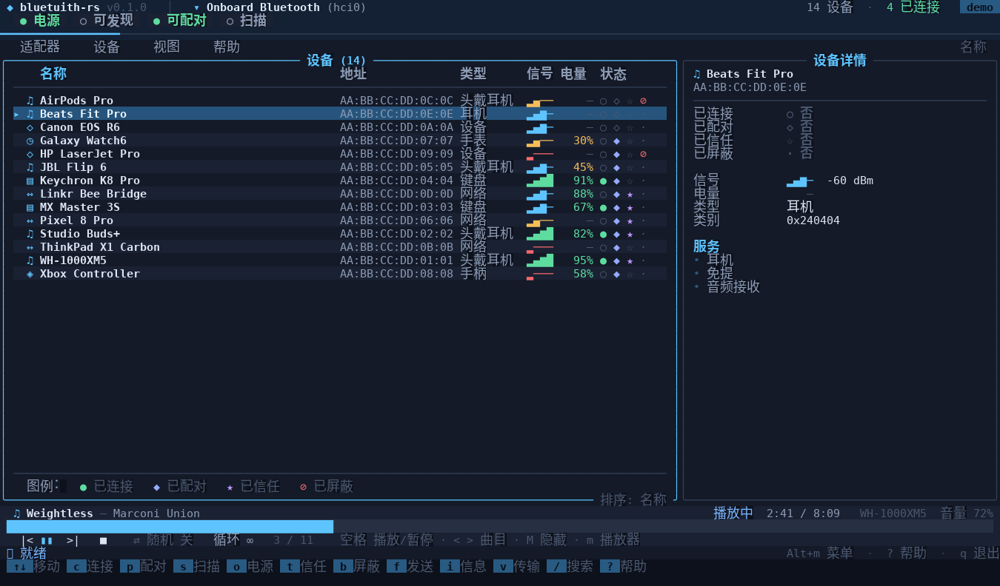
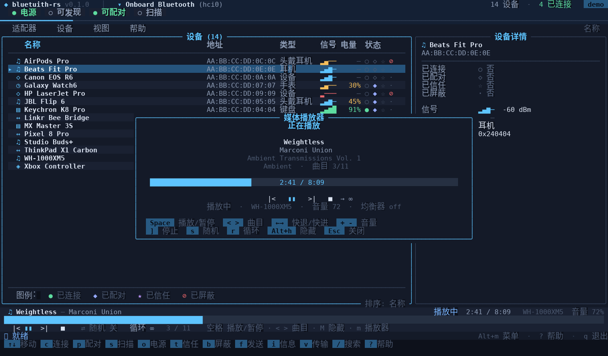
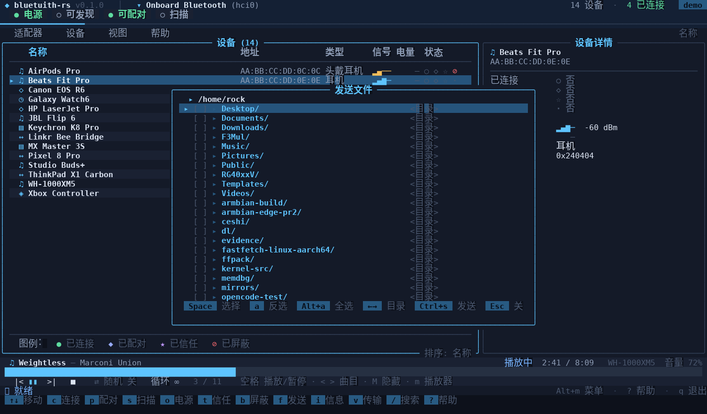
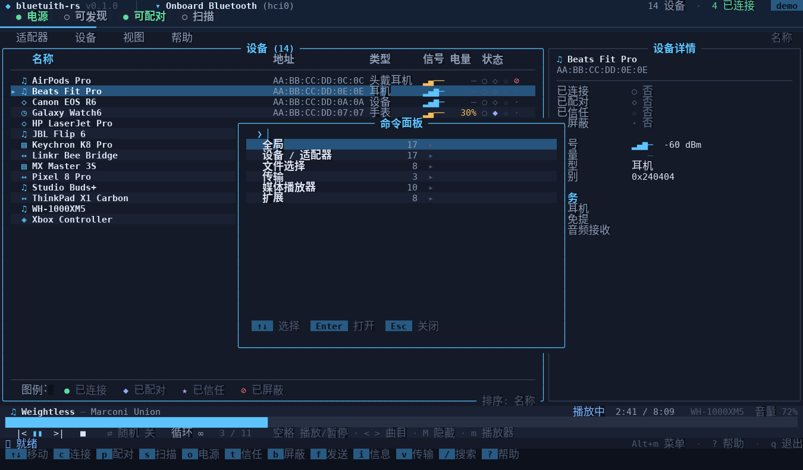
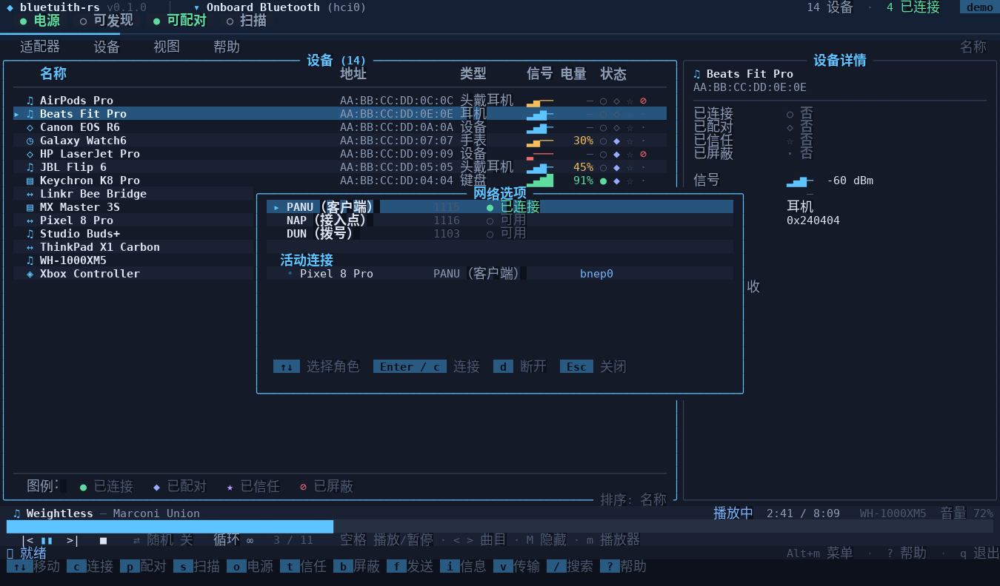
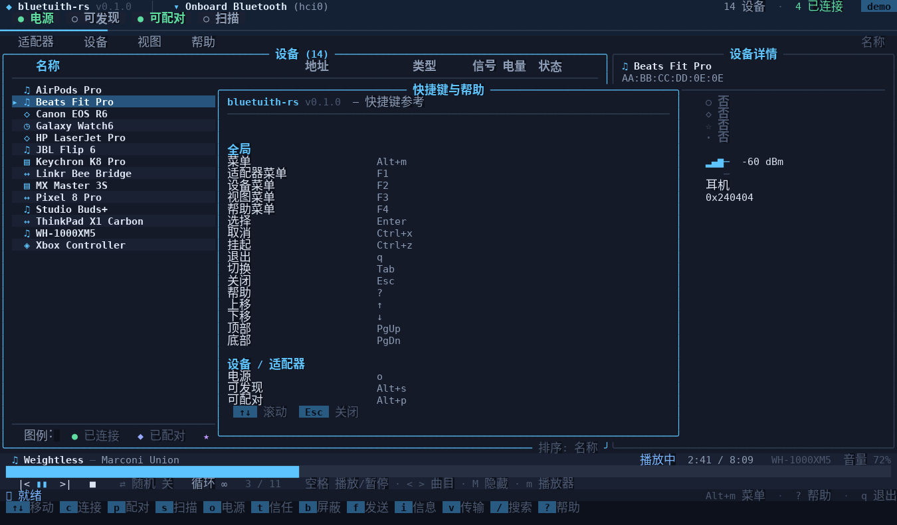
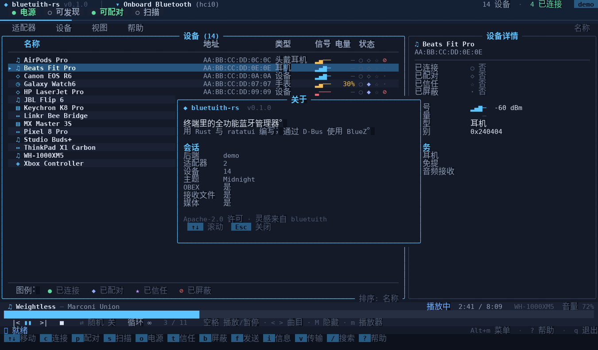

# bluetuith-rs

[](https://github.com/Novice-PG/bluetuith-rs/actions/workflows/debs.yml)
[](https://github.com/Novice-PG/bluetuith-rs/releases)
[](LICENSE)
[](https://www.rust-lang.org/)

一个运行在终端里的全功能蓝牙管理器，用 **Rust** 从零编写，基于
[ratatui](https://ratatui.rs/) 和 [zbus](https://github.com/dbus2/zbus)。

[English](README.md) · 简体中文



`bluetuith-rs` 是对 [bluetuith](https://github.com/bluetuith-org/bluetuith)
（一个 Go/tview 蓝牙 TUI）背后**理念**的干净室（clean-room）重新实现。
它不包含任何 Go 代码，也没有从 bluetuith 复制任何代码：数据模型、BlueZ
D-Bus 后端、事件循环和每个界面组件都是原创 Rust。它在功能上与原项目保持
对齐，并额外加入了一些特性。关于与原项目在法律上的关系，见
[起源、灵感与授权](#起源灵感与授权)。

---

## 目录

- [亮点](#亮点)
- [界面截图](#界面截图)
- [与 bluetuith 的功能对齐](#与-bluetuith-的功能对齐)
- [安装](#安装)
- [用法与按键](#用法与按键)
- [配置](#配置)
- [已知限制](#已知限制)
- [架构](#架构)
- [为所有 Linux 架构构建 `.deb` 包](#为所有-linux-架构构建-deb-包)
- [开发与测试](#开发与测试)
- [起源、灵感与授权](#起源灵感与授权)
- [许可证](#许可证)

## 亮点

- **通过 BlueZ D-Bus 完整管理蓝牙** — 适配器电源、可发现/可配对模式、扫描、
  设备连接/断开、配对、信任、屏蔽与移除。
- **实时设备列表** — 信号强度条、电量、设备类型、已配对/已连接/已信任/已屏蔽
  标记、搜索过滤和六种排序方式。
- **OBEX Object Push 收发** — 带文件选择器、每个传输的进度、暂停/继续/取消、
  来电文件的授权弹窗，以及 `receive-dir` 作为落地目录（通过
  `org.bluez.obex.Agent1`）。
- **媒体播放器**（AVRCP / `org.bluez.MediaPlayer1`）— 播放/暂停、上一首/下一首、
  快进快退、停止、音量、随机/循环、曲目元数据和迷你播放条。
- **PAN 网络**（PANU / NAP；DUN 保留）与 **音频 profile** 视图。
- **真正的配对 Agent** — PIN、passkey、数字比较、授权和来电文件提示都是会
  阻塞 D-Bus 的真实对话框，而不是装饰。
- **九套内置配色**、运行时切换主题、自定义强调色、可配置按键（带冲突检测）、
  完整鼠标支持、右键上下文菜单、两级命令面板、事件日志和帮助。
- **双语界面** — 英文和中文（中文），根据 `$LANG` 自动检测，可用 `L` 键或
  `--lang` / `language = "zh"` 在运行时切换。
- **`--demo` 模式** — 一个完全可交互的模拟适配器，因此即使在没有蓝牙硬件的
  机器上，每个界面也都能工作（且可测试）。
- **单个静态二进制** — 提供 12 个 Linux 架构的 `.deb` 包，除 D-Bus/BlueZ
  外无运行时依赖（`--demo` 下连这些都可省）。

## 界面截图

所有图片都由渲染代码通过 `examples/snapshot.rs` +
`packaging/render-snapshot.py` 直接生成（见[开发与测试](#开发与测试)），
因此它们始终反映真实界面。英文截图见 [README.md](README.md)。

<details>
<summary><b>主界面</b> — 设备表格、详情侧栏、图例、迷你播放器</summary>


</details>

<details>
<summary><b>媒体播放器</b> — AVRCP 控制、进度条、随机/循环、音量</summary>



</details>

<details>
<summary><b>文件选择器</b> — OBEX Object Push 发送，支持多选</summary>



</details>

<details>
<summary><b>命令面板</b> — 两级「分类 → 动作」启动器</summary>



</details>

<details>
<summary><b>网络</b> — PANU / NAP / DUN 角色与活动连接</summary>



</details>

<details>
<summary><b>帮助</b> — 由当前键位表实时生成的按键参考</summary>



</details>

<details>
<summary><b>关于</b> — 后端、功能标志与版本</summary>



</details>

## 与 bluetuith 的功能对齐

| 功能 | bluetuith (Go) | bluetuith-rs (Rust) |
|---|---|---|
| 适配器选择 + 状态指示 | ✓ | ✓ |
| 电源 / 可发现 / 可配对 / 扫描 | ✓ | ✓ |
| 连接 / 断开 / 配对 / 取消配对 | ✓ | ✓ |
| 信任 / 取消信任 / 屏蔽 / 取消屏蔽 / 移除 | ✓ | ✓ |
| 设备信息 + 服务 UUID | ✓ | ✓ |
| 文件选择器（选择 / 反选 / 全选 / 隐藏 / 刷新） | ✓ | ✓ |
| OBEX Object Push 发送 + 传输进度视图 | ✓ | ✓ |
| OBEX 接收 + `receive-dir` | ✓ | ✓（OBEX Agent1） |
| 传输暂停 / 继续 / 取消 | ✓ | ✓ |
| 配对 + 文件传输认证视图 | ✓ | ✓ |
| 媒体播放器（播放/暂停/下一首/上一首/快进/停止/随机/循环） | ✓ | ✓ |
| 网络选项（PAN/NAP/DUN） | ✓ | PANU / NAP ✓；DUN 保留 |
| 音频 profile | ✓ | 仅列出（BlueZ 没有切换 API） |
| 鼠标支持 | ✓ | ✓ |
| 可配置主题 + 按键 | ✓ | ✓ |
| 帮助 / 按键视图 | ✓ | ✓ |
| 挂起（`Ctrl+Z`）/ 退出确认 | ✓ | ✓ |
| CLI 参数 + 配置文件 + 环境变量 | ✓ | ✓ |
| `--list-adapters` 非交互模式 | ✓ | ✓ |
| 设备搜索 / 过滤 | — | ✓ |
| 六种排序方式 | — | ✓ |
| 电量 + RSSI + 设备类型图标 | — | ✓ |
| 详情侧栏 | — | ✓ |
| 九套配色 + 实时主题选择器 | — | ✓ |
| 命令面板、事件日志 | — | ✓ |
| 双语界面（英文 / 中文） | — | ✓ |
| `--demo` 模拟适配器 | — | ✓ |
| 静态多架构 `.deb` 包 | — | ✓ |

**关于表中三个「未完全对齐」项的说明**：

- **OBEX 接收 + `receive-dir`**：已完整实现。Rust 版注册了真正的
  `org.bluez.obex.Agent1`，来电文件弹授权框、写入 `receive-dir`，并通过
  `safe_filename` 防止目录穿越。唯一的保留是所有真机功能的共同说明——本地
  只验证了 D-Bus 契约，端到端推送仍需对端设备配合。
- **DUN 保留**：PANU / NAP 已完整实现（走 `Network1.Connect` + 完整 128 位
  UUID）。DUN 拨号是 **BlueZ 本身没有提供 API**（`Network1` 不支持拨号上网），
  因此选择 DUN 时会明确提示「not provided by BlueZ Network1」，而不是发出一个
  注定失败的调用。这是 BlueZ 的限制，不是半成品。
- **音频 profile 仅列出**：能列出设备支持的 A2DP/HFP/HSP/AVRCP，但无法切换，
  因为 BlueZ 没有切换音频 profile 的 API（那是 bluez-alsa/PipeWire/PulseAudio
  的职责）。真机上为只读；`--demo` 里可切换仅为演示。

## 安装

### Debian / Ubuntu 包

每个 GitHub Release 都附带 12 个架构的预编译 `.deb`。用
`packaging/build-debs.sh` 本地构建：

```sh
./packaging/build-debs.sh
sudo dpkg -i packaging/out/bluetuith-rs_0.1.0_amd64.deb   # 或 arm64、armhf、
                                                          # armel、i386、ppc64el、
                                                          # riscv64、loong64、ppc64
```

该包会安装 `/usr/bin/bluetuith-rs`、man 手册、desktop 入口、shell 补全和
示例配置。除系统 D-Bus 和 BlueZ 外无运行时依赖（`--demo` 模式下两者都可省）。

### 从源码构建

```sh
cargo build --release --bin bluetuith-rs
sudo install -m755 target/release/bluetuith-rs /usr/local/bin/
```

需要 Rust 1.85+。在 Linux 上唯一的系统要求是运行中的 D-Bus 系统总线；
BlueZ 可选（没有它就用 `--demo`）。

**蓝牙文件传输**还需要 `bluez-obexd`（`obexd` 守护进程）。在大多数发行版中
`org.bluez.obex` 是*会话*总线服务，因此程序会先在会话总线上探测/激活它，
再回退到系统总线。如果没有 OBEX 服务，「发送文件」动作会被禁用，界面会
提示你启动它，例如：

```sh
sudo apt install bluez-obexd
systemctl --user start obex.service
```

## 用法与按键

```sh
bluetuith-rs                 # 连接 BlueZ
bluetuith-rs --demo          # 用模拟适配器运行
bluetuith-rs --theme Nord    # 选择配色
bluetuith-rs --list-adapters # 打印适配器并退出
bluetuith-rs --generate      # 写出默认配置文件
bluetuith-rs --help
```

### 主要按键

| 按键 | 动作 | 按键 | 动作 |
|---|---|---|---|
| `↑` `↓` | 上下导航 | `c` | 连接 / 断开 |
| `p` | 配对 | `t` | 信任 / 取消信任 |
| `b` | 屏蔽 / 取消屏蔽 | `d` | 移除设备 |
| `o` | 电源 | `s` | 扫描 |
| `Alt+s` | 可发现 | `Alt+p` | 可配对 |
| `a` | 切换适配器 | `f` | 发送文件 |
| `v` | 传输列表 | `m` | 媒体播放器 |
| `Alt+h` | 隐藏播放器 | `n` | 网络选项 |
| `Alt+a` | 音频 profile | `i` | 设备信息 |
| `/` | 搜索 / 过滤 | | |
| `F1` `F2` `F3` `F4` | 适配器 / 设备 / 视图 / 帮助 菜单 |
| `F5` | 切换排序 | `F6` | 切换详情 |
| `F7` | 主题选择器 | `F8` | 事件日志 |
| `F9` | 关于 | `Ctrl+p` | 命令面板 |
| `Alt+m` | 菜单栏 | `l` | 切换语言（en / zh） |
| `?` | 帮助 | `q` | 退出 |
| `Ctrl+z` | 挂起 | `Ctrl+x` | 取消 |
| `Esc` | 关闭弹窗 | | |

在媒体播放器窗口中：`Space` 播放/暂停，`<` `>` 上一首/下一首，`←` `→`
快退/快进，`+` `-` 音量，`]` 停止，`s` 随机，`r` 循环，`Alt+h` 隐藏。

双击设备行即可连接；右键打开设备上下文菜单。`Esc` 关闭任意弹窗。每个按键
都可覆盖——见下文。

### 配置

`~/.config/bluetuith-rs/config.toml`（或 `$XDG_CONFIG_HOME`）。用 `--generate`
生成带注释的默认配置：

```toml
adapter = "hci0"
receive-dir = ""
gsm-number = "*99#"
adapter-states = "powered:yes,discoverable:no,scan:no"
connect-bdaddr = ""
confirm-on-quit = true
no-help-display = false
theme = "Midnight"
accent = "#5ec4ff"
default-sort = "Name"
language = "zh"            # en | zh，或从 $LANG 自动检测
show-hidden-files = false
scan-on-start = false

[keybindings]
# Quit = "Ctrl+q"
# Connect = "c"
```

所有选项也有对应的 `--flag` 和 `BLUETUITH_RS_*` 环境变量。内置配色：
**Midnight**、**Nord**、**Catppuccin**、**Dracula**、**Gruvbox**、
**Tokyo Night**、**Rosé Pine**、**Solarized**、**Daylight**。

## 已知限制

- **音频 profile** 仅供查看。BlueZ 没有切换 A2DP/HFP 的 API——那是
  `bluez-alsa`、PipeWire 或 PulseAudio 负责的——因此在真机上 profile 窗口是
  只读的（`--demo` 模拟器可以切换）。
- **OBEX 文件传输**需要 `bluez-obexd`。来电文件通过注册的
  `org.bluez.obex.Agent1` 授权，并写入 `receive-dir`（默认
  `~/Downloads/bluetuith-rs`）。传输通过 OBEX `Transfer1` D-Bus 接口控制。
  真实的来电推送仍需要对端设备；本地只验证了 D-Bus 契约。
- **DUN 拨号**（`gsm-apn` / `gsm-number`）为将来的 PPP 实现保留。选择 DUN
  角色会报告「not provided by BlueZ `Network1`」，而不是发出一个无法工作的
  调用；只有 PANU/NAP 会走 `Network1.Connect`（使用完整 128 位 UUID）。设置
  任一 GSM 选项也会在启动时打印警告，说明它们目前无效。
- **网络列表**由已连接设备及其通告的服务 UUID 合成——BlueZ 没有暴露独立的
  BNEP 连接对象。断开会被记住一个会话周期，以免下次轮询时重新出现。
- **播放器音量**在适配器暴露 `org.bluez.MediaTransport1.Volume` 时通过它调整；
  否则必须使用系统混音器。随机/循环写入 `MediaPlayer1.Shuffle` / `Repeat`
  （播放器窗口中的 `s` / `r`）。
- **命令面板**是两级结构（分类 → 命令）；第二级按 `Esc` 返回分类列表。
  窗口相关命令会打开其所属窗口。
- 原始 D-Bus 错误文本刻意保留英文以便诊断；其他所有界面和状态文本均已翻译。
- **未做端到端验证**（需要对端蓝牙设备）：真实配对对话框交互、与手机的 AVRCP
  播放、实时 PAN 连接、真实来电 OBEX 推送。D-Bus 调用和参数由
  `examples/contract.rs` 对着一个假 BlueZ 服务校验，`examples/real_prop.rs`
  在真机上验证适配器属性的写入。

## 架构

```
src/
├── model.rs          纯数据类型（无终端、无 D-Bus）
├── backend/
│   ├── mod.rs        Backend trait、Command/Event、服务名
│   ├── bluez.rs      通过 zbus 连接 BlueZ（工作线程上的阻塞 D-Bus）
│   └── demo.rs       确定性模拟器，供 --demo 和测试使用
├── app.rs            应用状态 + 所有输入处理
├── config.rs         TOML 配置、CLI/环境变量覆盖
├── keybind.rs        可配置按键 + 冲突检测
├── theme.rs          配色方案
├── i18n.rs           中英文文本表 + 后端状态翻译
├── ui/               ratatui 渲染（chrome、views、overlays）
└── main.rs           CLI 入口、终端初始化、事件循环
```

界面从不直接触碰 BlueZ：它发送 `Command` 并对 `Event` 作出反应。BlueZ
工作线程在 `org.bluez` 上轮询
`org.freedesktop.DBus.ObjectManager.GetManagedObjects`（可用时也轮询
`org.bluez.obex`），通过 `org.bluez.*` 方法执行操作，并注册配对用的
`org.bluez.Agent1` 和 OBEX 接收用的 `org.bluez.obex.Agent1`，两者都会阻塞
直到用户在弹窗中作答。采用轮询而非信号订阅，是为了让状态机保持简单，并能
容忍 BlueZ 众多可选接口的变化。

功能可用性在运行时上报：如果 `obexd` 或媒体播放器不存在，相应控件仍显示，
但会报告服务不可用。

## 为所有 Linux 架构构建 `.deb` 包

`packaging/build-debs.sh` 使用 `rustup target add` + Rust 自带的 `rust-lld`
为每个目标交叉编译**静态**二进制（因此不需要交叉 C 工具链），再用
`dpkg-deb` 打包：

```sh
./packaging/build-debs.sh                 # 所有支持的目标
./packaging/build-debs.sh aarch64-unknown-linux-musl   # 单个目标
```

| Debian 架构 | Rust 目标 | Debian 架构 | Rust 目标 |
|---|---|---|---|
| `amd64` | `x86_64-unknown-linux-musl` | `arm64` | `aarch64-unknown-linux-musl` |
| `armhf` | `armv7-unknown-linux-musleabihf` | `armel` | `arm-unknown-linux-musleabi` |
| `i386` | `i686-unknown-linux-musl` | `ppc64el` | `powerpc64le-unknown-linux-musl` |
| `riscv64` | `riscv64gc-unknown-linux-musl` | `loong64` | `loongarch64-unknown-linux-musl` |
| `ppc64` | `powerpc64-unknown-linux-musl` | | |

Rust 只提供 `*-linux-gnu` std 的架构（`s390x`、`sparc64`、`mips*`）由
`.github/workflows/debs.yml` 中的 GitHub Actions 矩阵使用 Debian 交叉工具链
构建。每个包都用 `dpkg-deb --info` 校验。

## 开发与测试

```sh
cargo test --all-targets                                # 单元 + 集成测试
cargo clippy --all-targets -- -D warnings
cargo run --example snapshot -- 150 44 main /tmp/frame.json   # 把界面渲染成 JSON
python3 packaging/render-snapshot.py /tmp/frame.json /tmp/frame.png
cargo run --example full_sim                            # 端到端功能检查（demo）
dbus-run-session -- cargo run --example contract        # 底层 BlueZ D-Bus 契约
cargo run --example real_prop                           # 真机属性 写入→回读→还原
```

`examples/snapshot.rs` 把任意界面渲染到 `TestBackend` 并导出每个单元格；
上面的截图就是不用真实终端生成出来的。`examples/full_sim.rs` 用 demo 后端
驱动真实的 `App` 状态机，断言每个动作、弹窗、鼠标路径和命令都真正生效。

`examples/contract.rs` 是最底层的检查：它在私有 D-Bus 总线上启动一个**假
BlueZ 服务**，通过 `DBUS_SYSTEM_BUS_ADDRESS` 把真实的 `BluezBackend` 指向
它，断言真实的 D-Bus 流量（方法名、接口、参数值、完整 128 位 UUID、OBEX 用
会话总线还是系统总线），以及对手工构造的 `GetManagedObjects` 响应的解析
（包括变体整数宽度和缺失属性）。它还验证慢速 OBEX 调用不会阻塞轮询线程——
无需硬件和 root。`examples/real_prop.rs` 则相反：在真机上让程序设置
`Discoverable`，通过另一条 D-Bus 连接回读该值，然后还原。

## 起源、灵感与授权

本项目的灵感来自 **[bluetuith](https://github.com/bluetuith-org/bluetuith)**，
即 **darkhz** 用 Go/tview 编写的蓝牙 TUI，以 **MIT 许可证**发布
（`Copyright (c) 2022 darkhz`）。我们感谢它开创的设计和功能集；这个 Rust
项目是对该*理念*的独立重新实现，而非其源代码的移植或衍生作品。

### 用 Rust 重写 Go 项目会有版权问题吗？

简短回答：**用独立编写的代码、以不同语言实现相同功能是合法的**，而在这个
具体案例里更是站得很稳。理由如下：

- **版权保护表达，不保护思想或功能。** 美国法律（17 U.S.C. §102(b) 和版权局
  的 [2016 软件报告](https://www.copyright.gov/policy/software/software-full-report.pdf)）
  明确排除了思想、程序、系统和操作方法。欧盟在 *SAS Institute v World
  Programming*（CJEU C-406/10）中得出同样结论：程序的功能、编程语言和数据
  格式不受软件版权保护。因此编写新的 Rust 代码去完成 Go 程序所做的事，本身
  并不构成侵权。
- **干净室重新实现是成熟且合法的行业做法。** 美国版权局报告指出，干净室实现
  「long been used … to ensure the development of competitive products」（经典
  例子是 Phoenix 的 BIOS）。本项目以原创 Rust 编写——没有 Go 源码、没有翻译
  Go 文件、没有复制代码。
- **原项目是 MIT——最宽松的许可证之一。** 即使在「万一复用了某个片段」的假设
  情形下，MIT 许可证也授予「use, copy, modify, merge, publish, distribute,
  sublicense, and/or sell」副本的权利。它唯一的条件是保留版权和许可声明。
  MIT 是[宽松且 GPL 兼容的](https://www.gnu.org/licenses/license-list.html)，
  与本项目采用的 Apache-2.0 完全兼容。
- **我们刻意*没有*复制的东西：** 上游源代码、logo/图标、截图、文档文案，以及
  「bluetuith」这个产品名/商标。本项目以 **bluetuith-rs** 发布，明确致谢上游，
  且不声称有任何关联或背书。像「Connect」「Pair」这样的界面标签和功能配置键
  由蓝牙领域本身决定，不属于受保护的表达（*merge* 与 *scènes à faire* 原则）。

为求完整——尽管干净室重写在法律上并不要求——上游的 MIT 许可证文本和版权
声明保留在 [NOTICE](NOTICE) 中，作为署名记录。

> 以上是一般信息，而非法律意见。如果你需要针对商业或发行场景的权威评估，
> 请咨询合格的律师。

## 许可证

Apache-2.0。见 [LICENSE](LICENSE)。上游署名记录见 [NOTICE](NOTICE)。
